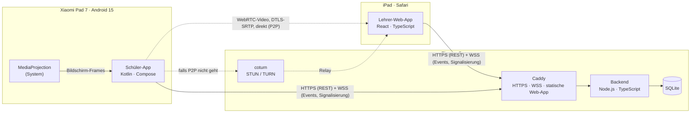
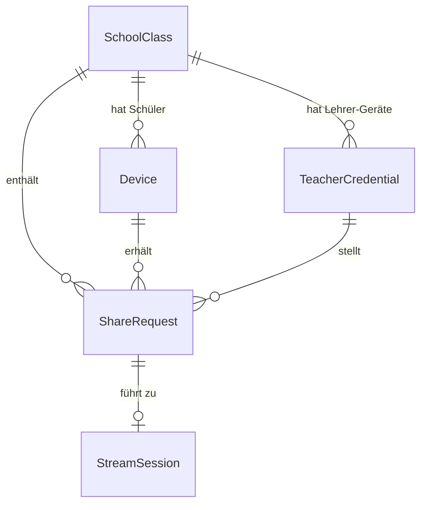
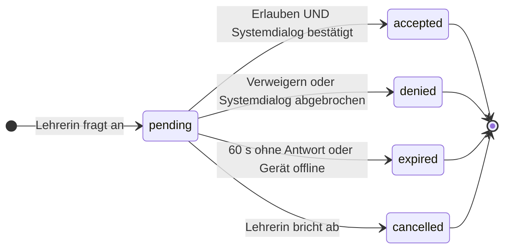
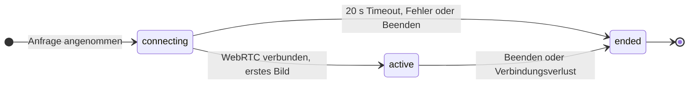
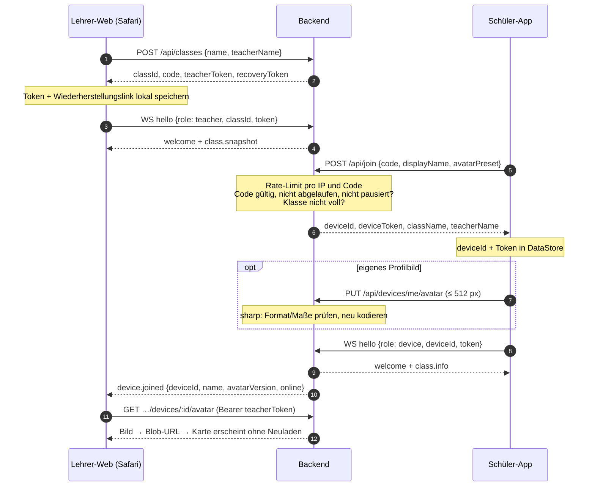
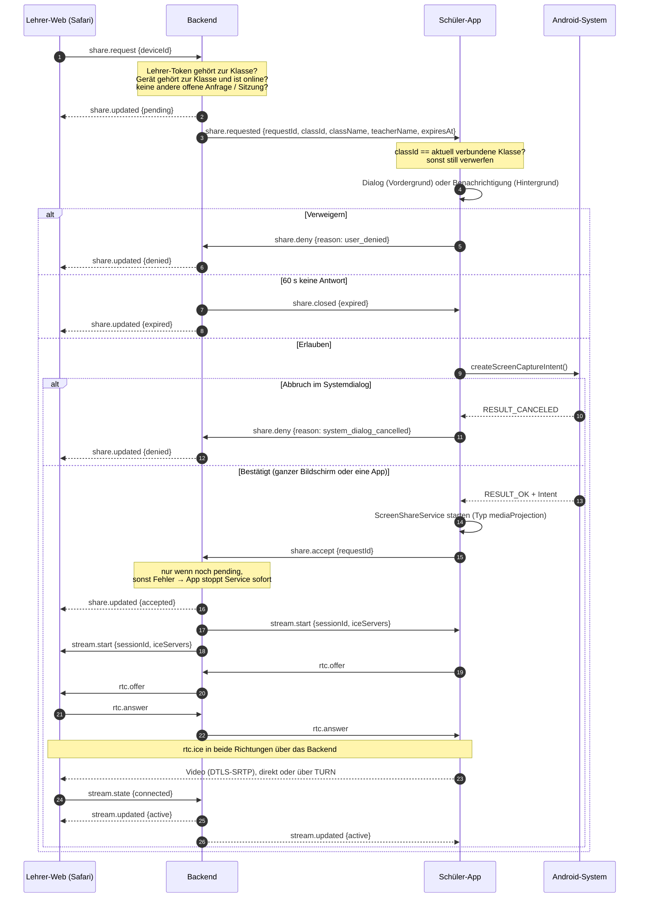
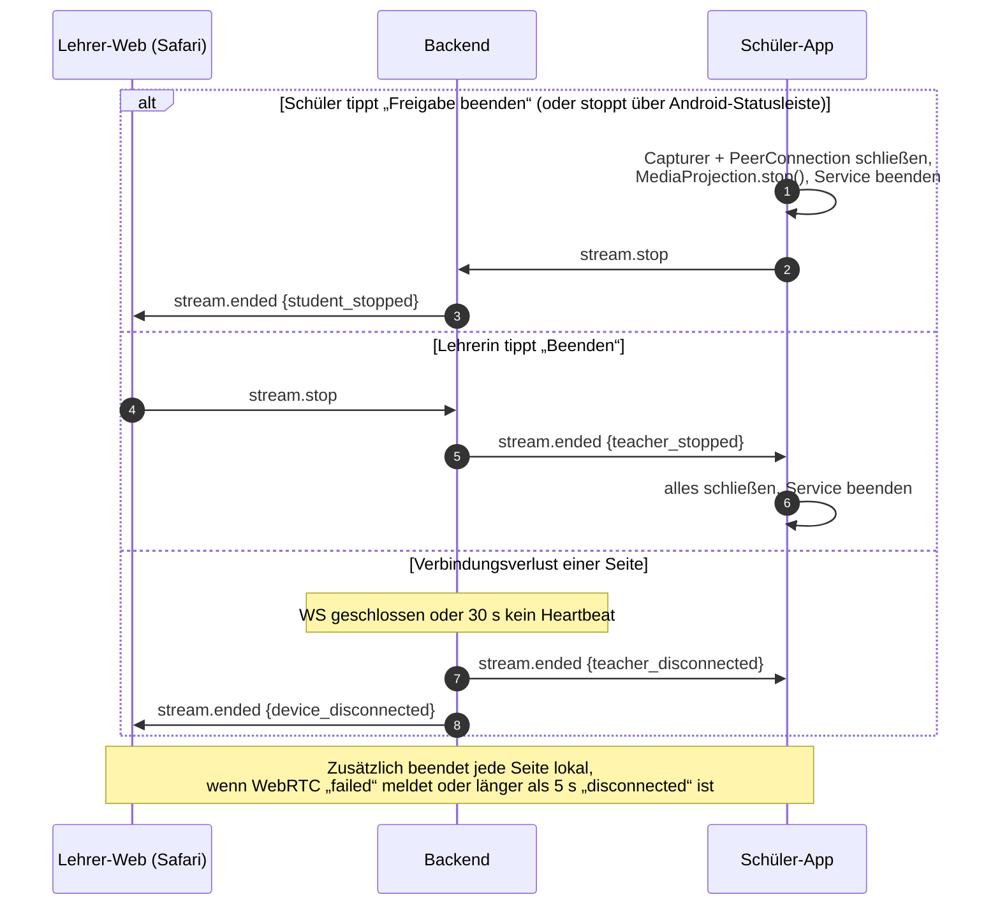

# Architektur

Stand: Phase 1. Dieses Dokument beschreibt *was* gebaut wird und *warum*. Konkrete Bibliotheksversionen
werden erst in der Phase festgelegt, in der sie eingeführt werden, und dann gegen npm bzw. Maven Central
geprüft. Wo ich mir bei einer API oder einem Plattformverhalten nicht sicher bin, steht das ausdrücklich
als **Zu prüfen** dabei.

---

## 1. Überblick



**Grundprinzipien**

1. **Backend ist die einzige Autorität** für Klassen, Mitgliedschaften, Anfragen und Sitzungen. Clients
   schicken Absichten (`share.request`, `share.accept` …), das Backend prüft und verteilt den neuen Zustand.
2. **Video fließt nie durch das Backend.** Das Backend vermittelt nur die WebRTC-Signalisierung (SDP, ICE).
   Medien gehen direkt Peer-to-Peer oder, falls nötig, verschlüsselt über coturn. Nichts wird aufgezeichnet.
3. **Zustimmung ist zweistufig und liegt beim Gerät:** App-Dialog *und* Android-Systemdialog. Das Backend
   kann einen Stream weder erzwingen noch starten.
4. **Jede Phase ist lauffähig.** Die Schnittstellen unten sind so geschnitten, dass Phase 3–6 ohne WebRTC
   funktionieren.

---

## 2. Technikwahl

| Teil | Wahl | Begründung |
|---|---|---|
| Backend-Laufzeit | Node.js (LTS) + TypeScript | wie vorgeschlagen; ein Prozess reicht für den Prototyp |
| HTTP | **Fastify** | eingebaute Schema-Validierung, schlank, gute TypeScript-Typen |
| WebSocket | **`ws`** (über `@fastify/websocket`, das auf `ws` aufsetzt) | Statt Socket.IO: Socket.IO hat ein eigenes Protokoll und bräuchte auf Android eine zusätzliche Client-Bibliothek. Mit reinem WebSocket nutzt Android direkt **OkHttp**, der Browser die native `WebSocket`-API. Reconnect und Zustandsabgleich bauen wir ohnehin selbst (siehe §7). |
| Validierung | `zod` (Nachrichten) bzw. Fastify-JSON-Schema (REST) | Jede eingehende Nachricht wird typgeprüft, bevor sie Logik erreicht |
| Datenbank | SQLite über **`better-sqlite3`** | synchron, robust, keine Extra-Infrastruktur; Datei liegt in einem Docker-Volume |
| Bildprüfung | **`sharp`** | dekodiert Profilbilder, prüft Format und Maße und **kodiert neu** (entfernt EXIF/Metadaten, verhindert Polyglot-Dateien) |
| Tests Backend | Vitest | schnell, TypeScript ohne Zusatzkonfiguration |
| Lehrer-Web | React + TypeScript + Vite, eigenes CSS mit CSS-Variablen | kein UI-Framework; Hell/Dunkel über `prefers-color-scheme` |
| Web-Zustand | kleiner eigener Store (`useSyncExternalStore`) | keine Redux-Abhängigkeit nötig |
| QR-Code (optional) | npm-Paket `qrcode` | rendert lokal im Browser, keine externe API |
| Android | Kotlin, Jetpack Compose, Material 3, eine Activity, Navigation Compose | |
| Android-Netzwerk | **OkHttp** (REST + WebSocket), `kotlinx.serialization` | OkHttp bringt WebSocket und Ping-Intervall mit |
| Android-Speicher | **DataStore** (Preferences) | Profil, gespeicherte Klasse, Geräte-Token |
| Bildauswahl | Photo Picker (`ActivityResultContracts.PickVisualMedia`) | braucht keine Speicherberechtigung |
| Android-WebRTC | **`io.getstream:stream-webrtc-android`** (siehe unten) | |
| TURN | **coturn** mit zeitlich begrenzten Zugangsdaten (`use-auth-secret`) | Standard, selbst hostbar |
| Reverse Proxy | **Caddy** | automatisches Let's-Encrypt-Zertifikat, WebSocket-Proxy ohne Zusatzkonfiguration; für lokale Tests `tls internal` |

### 2.1 WebRTC-Bibliothek für Android

Google veröffentlicht seit Jahren kein offizielles, gepflegtes Android-Artefakt mehr (`org.webrtc:google-webrtc`
ist veraltet und nicht mehr über die üblichen Repositories verfügbar). Selbst bauen ist möglich, kostet aber
Stunden Build-Zeit und viel Plattenplatz. Realistische Optionen:

| Option | Bewertung |
|---|---|
| **`io.getstream:stream-webrtc-android`** (GetStream, Apache 2.0, Maven Central) | Vorkompiliertes **upstream-libwebrtc** mit der Standard-API `org.webrtc.*` (u. a. `PeerConnectionFactory`, `ScreenCapturerAndroid`, `SurfaceTextureHelper`, Hardware-Encoder-Factories). Regelmäßig an neue Chromium-Releases angepasst. Wir nutzen nur das Basis-Artefakt, nicht deren Video-SDK. → **Wahl** |
| `io.github.webrtc-sdk:android` (von LiveKit gepflegt) | ebenfalls upstream-libwebrtc mit `org.webrtc.*`-API, gute Alternative |
| Selbst gebautes libwebrtc | volle Kontrolle, aber für dieses Projekt unverhältnismäßig |

Weil beide Kandidaten dieselbe `org.webrtc`-API bereitstellen, ist ein späterer Wechsel billig.
**Zu prüfen in Phase 7:** exakte aktuelle Version auf Maven Central; ob `ScreenCapturerAndroid` in dieser
Version bei Größenänderung `VirtualDisplay.resize()` nutzt oder das virtuelle Display neu erzeugt (Letzteres
ist ab Android 14 pro MediaProjection nur einmal erlaubt). Falls nötig schreiben wir einen eigenen schlanken
Capturer (VirtualDisplay → `SurfaceTextureHelper` → `VideoSource`).

### 2.2 Videoparameter (Startwerte, in Phase 7 messen)

- Codec: **H.264** bevorzugt (Hardware-Encoder auf dem Snapdragon im Pad 7, Safari dekodiert hardwarebeschleunigt),
  Fallback VP8 (Software). Safari unterstützt beide.
- Auflösung: lange Kante max. **1920 px** (Pad 7 hat 3200 × 2136, das wäre unnötig viel), 15–30 fps.
- `degradationPreference = MAINTAIN_RESOLUTION`: Bei Bandbreitenmangel lieber weniger Bilder pro Sekunde als
  unlesbarer Text.
- Nur Video, **kein Audio-Track**. Dadurch darf das `<video>` in Safari `muted` sein und startet ohne
  Autoplay-Probleme (zusätzlich `playsinline`, Start nach einer Benutzergeste).

---

## 3. Komponenten im Detail

### 3.1 Backend

- **REST** für alles, was eine einfache Anfrage/Antwort ist (Klasse erstellen, beitreten, Profilbild hochladen).
- **WebSocket `/ws`** für Live-Ereignisse und Signalisierung. Nach dem Verbindungsaufbau muss die **erste
  Nachricht** `hello` mit Token sein, sonst wird nach 5 s geschlossen. (Tokens nicht in die URL, weil URLs in
  Proxy-Logs landen; der Browser kann bei WebSockets keine eigenen Header setzen.)
- **In-Memory-Zustand:** welche Verbindungen online sind, Rate-Limit-Zähler, Timer für Anfragen.
  Dauerhafte Daten (Klassen, Geräte, Anfragen, Sitzungen als Protokoll ohne Inhalte) in SQLite.
- **Beim Start** werden alle `pending`-Anfragen auf `expired` und alle offenen Sitzungen auf `ended`
  (`server_restart`) gesetzt → nach einem Neustart gibt es nichts Verwaistes.
- Ein einzelner Prozess. Horizontale Skalierung ist für den Prototyp bewusst nicht vorgesehen.

### 3.2 Lehrer-Web-App

- Wird von Caddy als statische Dateien ausgeliefert (gleicher Origin wie API → kein CORS nötig).
- **PWA-Manifest** + `apple-mobile-web-app-capable`, damit sie vom Home-Bildschirm ohne Safari-Leisten startet.
  Wichtig: Home-Bildschirm-App und Safari-Tab haben **getrennten Speicher** – eine Klasse, die im Tab
  erstellt wurde, ist in der Home-Bildschirm-App erst nach Öffnen des Wiederherstellungslinks sichtbar.
- Speichert pro Klasse lokal (`localStorage`): `classId`, Klassenname, Lehrer-Token, Wiederherstellungslink.
- **Profilbilder** werden per `fetch` mit `Authorization`-Header geladen und als Blob-URL angezeigt (ein
  normales `` könnte keinen Header mitsenden; so gibt es keine öffentlichen Bild-URLs).
- Routen (Hash-basiert, kein Server-Routing nötig): `#/` Start, `#/class/:id` Klasse,
  `#/class/:id/student/:deviceId` Detail, `#/recover/<token>` Wiederherstellung (Fragment wird nie an den
  Server übertragen).

### 3.3 Android-App

```
MainActivity (Compose, edge-to-edge)
 ├─ Screens: Start · Profil · Beitreten · Beigetreten · Freigabe-Dialog · HyperOS-Hinweis
 ├─ ViewModels (StateFlow)
 ├─ ProfileRepository        – DataStore: Name, Avatar (Preset oder lokale Bilddatei)
 ├─ ClassRepository          – DataStore: Server-URL, classId, deviceId, deviceToken, Klassenname
 ├─ ClassConnection          – OkHttp-WebSocket, Heartbeat, Reconnect mit Backoff, Events als Flow
 ├─ ClassPresenceService     – (Vorschlag, siehe Offene Fragen) Foreground Service „Mit Klasse verbunden“
 └─ ScreenShareService       – Foreground Service, Typ mediaProjection; hält MediaProjection,
                               PeerConnection und Capturer für genau eine Sitzung
```

- Server-URL ist im Release-Build fest eingebaut (`BuildConfig`); im Debug-Build in einer versteckten
  Entwickleroption änderbar (für den WLAN-Test).
- `minSdk` 29, `targetSdk` 35 (Android 15). **Zu prüfen in Phase 4:** ob für das Pad bereits ein Update auf
  Android 16 vorliegt; dann testen wir zusätzlich dagegen.
- Profilbild wird **auf dem Gerät** auf max. 512 px verkleinert und als JPEG (Qualität ~85) hochgeladen.
- Backups deaktiviert (`allowBackup=false` bzw. `dataExtractionRules`), damit das Geräte-Token nicht in
  Cloud-Backups landet.

---

## 4. Datenmodell



Im Diagramm und im Code heißt `Class` **`SchoolClass`**, weil `class` in Mermaid ein Schlüsselwort ist und
`Class` in Kotlin mit `java.lang.Class` kollidiert. Alle IDs sind zufällige UUIDv4. Alle Zeitstempel in UTC (ISO 8601 in JSON, Unix-ms in SQLite).
Geheimnisse werden nur als **SHA-256-Hash** gespeichert (die Tokens haben 256 Bit Zufall, daher ist ein
langsamer Passwort-Hash nicht nötig).

### `Class`

| Feld | Typ | Beschreibung |
|---|---|---|
| `id` | UUID | interne Klassen-ID |
| `name` | text (1–60) | Klassenname |
| `teacherName` | text (0–60), optional | wird dem Schüler bei Anfragen angezeigt |
| `code` | text(6), unique, nullable | aktueller Beitrittscode; `null` = kein gültiger Code |
| `codeCreatedAt` | timestamp | |
| `codeExpiresAt` | timestamp, nullable | optionaler Ablauf (z. B. 1 h / 1 Tag / 7 Tage / nie) |
| `joinPaused` | bool | Beitritt vorübergehend gesperrt, Code bleibt erhalten |
| `maxDevices` | int | Standard 40 |
| `recoveryTokenHash` | text | Hash des Wiederherstellungs-Geheimnisses |
| `createdAt`, `lastActivityAt` | timestamp | `lastActivityAt` für automatisches Aufräumen inaktiver Klassen |

### `TeacherCredential` (zusätzlich zu den Mindest-Entitäten)

Eine Klasse kann auf mehreren Lehrer-Geräten geöffnet sein (z. B. iPad und Laptop via Wiederherstellungslink).
Jedes Gerät bekommt ein eigenes Lehrer-Token, damit man einzelne Geräte abmelden kann.

| Feld | Typ | Beschreibung |
|---|---|---|
| `id` | UUID | |
| `classId` | UUID → Class | |
| `tokenHash` | text, unique | |
| `label` | text | grobe Gerätebeschreibung (z. B. „iPad · Safari“), nur zur Anzeige |
| `createdAt`, `lastUsedAt` | timestamp | |
| `revokedAt` | timestamp, nullable | abgemeldet |

### `Device` (Schüler in einer Klasse)

| Feld | Typ | Beschreibung |
|---|---|---|
| `id` | UUID | Geräte-ID, Zuordnung **nur** hierüber, nie über den Namen |
| `classId` | UUID → Class | ein Device-Eintrag gehört zu genau einer Klasse |
| `tokenHash` | text, unique | Hash des Geräte-Tokens |
| `displayName` | text (1–40) | |
| `avatarKind` | `preset` \| `image` | |
| `avatarPreset` | text, nullable | Schlüssel eines eingebauten Avatars (eigene Grafiken, in Web und App identisch) |
| `avatarImage` | blob, nullable | neu kodiertes Bild, max. 512 × 512 |
| `avatarVersion` | int | wird bei jeder Änderung erhöht (Cache-Invalidierung) |
| `connection` | `online` \| `offline` | Laufzeitstatus, wird zusätzlich persistiert |
| `lastSeenAt` | timestamp | letztes Lebenszeichen |
| `joinedAt` | timestamp | |
| `removedAt` | timestamp, nullable | von der Lehrerin entfernt oder selbst ausgetreten → Token ungültig |

### `ShareRequest`

| Feld | Typ | Beschreibung |
|---|---|---|
| `id` | UUID | |
| `classId`, `deviceId` | UUID | Ziel: genau ein Gerät |
| `teacherCredentialId` | UUID | wer angefragt hat |
| `status` | `pending` \| `accepted` \| `denied` \| `expired` \| `cancelled` | |
| `reason` | text, nullable | z. B. `user_denied`, `system_dialog_cancelled`, `timeout`, `device_offline`, `teacher_cancelled` |
| `createdAt`, `expiresAt`, `respondedAt` | timestamp | `expiresAt` = `createdAt` + 60 s |

### `StreamSession`

| Feld | Typ | Beschreibung |
|---|---|---|
| `id` | UUID | |
| `shareRequestId` | UUID, unique | jede Sitzung gehört zu genau einer angenommenen Anfrage |
| `classId`, `deviceId`, `teacherCredentialId` | UUID | |
| `status` | `connecting` \| `active` \| `ended` | |
| `endReason` | text, nullable | `student_stopped`, `teacher_stopped`, `device_disconnected`, `teacher_disconnected`, `connection_failed`, `projection_stopped`, `connect_timeout`, `device_removed`, `server_restart` |
| `createdAt`, `startedAt`, `endedAt` | timestamp | |

Gespeichert werden **nur Metadaten** – nie Bild- oder Videoinhalte.

### Zustandsautomaten



Alle Endzustände sind **endgültig**. Das Backend setzt Status nur mit einer bedingten Aktualisierung
(`UPDATE … SET status = ? WHERE id = ? AND status = 'pending'`). Ein `share.accept` auf eine bereits
abgelehnte oder abgelaufene Anfrage wird daher immer abgewiesen – eine Ablehnung kann nie nachträglich zur
Zustimmung werden.



---

## 5. Schnittstellen

### 5.1 REST (`/api`)

| Methode & Pfad | Auth | Zweck |
|---|---|---|
| `POST /api/classes` | – (rate-limitiert) | Klasse anlegen → `classId`, `code`, `teacherToken`, `recoveryToken` |
| `POST /api/classes/recover` | Recovery-Token im Body | neues Lehrer-Token für dieses Gerät |
| `GET /api/classes/:classId` | Lehrer | kompletter Stand (Klasse, Schüler, offene Anfragen, Sitzung) |
| `PATCH /api/classes/:classId` | Lehrer | Name, Lehrkraftname, Ablaufzeit, `joinPaused` |
| `POST /api/classes/:classId/code` | Lehrer | Code erneuern (alter Code sofort ungültig) |
| `POST /api/classes/:classId/recovery` | Lehrer | Wiederherstellungslink erneuern |
| `GET /api/classes/:classId/teachers` · `DELETE …/teachers/:id` | Lehrer | Lehrer-Geräte anzeigen / abmelden |
| `DELETE /api/classes/:classId/devices/:deviceId` | Lehrer | Schüler entfernen |
| `GET /api/classes/:classId/devices/:deviceId/avatar` | Lehrer | Profilbild (nur mit Token) |
| `DELETE /api/classes/:classId` | Lehrer | Klasse löschen (inkl. aller Geräte und Bilder) |
| `POST /api/join` | – (rate-limitiert) | Code + Name + Avatar-Preset → `deviceId`, `deviceToken`, Klassenname, Lehrkraftname |
| `PATCH /api/devices/me` | Gerät | Name / Avatar-Preset ändern |
| `PUT /api/devices/me/avatar` | Gerät | Profilbild hochladen (max. 1 MB, JPEG/PNG/WebP) |
| `DELETE /api/devices/me` | Gerät | Klasse verlassen |

Auth immer per `Authorization: Bearer <token>`; Lehrer-Token sind an genau eine `classId` gebunden,
Geräte-Token an genau ein `Device`.

### 5.2 WebSocket-Nachrichten (`/ws`)

Umschlag: `{ "type": "...", "id"?: "<client-msg-id>", "data": { ... } }`. Unbekannte Typen und ungültige
Daten werden mit `error` beantwortet und nicht verarbeitet.

| Richtung | Typ | Inhalt / Bedeutung |
|---|---|---|
| C → S | `hello` | `{ role: "teacher", classId, token }` oder `{ role: "device", deviceId, token }` |
| S → C | `welcome` / `error` | Erfolg mit Server-Zeit bzw. Fehlercode (`invalid_token`, `device_removed`, `class_deleted` …) |
| C ↔ S | `ping` / `pong` | Heartbeat alle 10 s |
| S → Lehrer | `class.snapshot` | vollständiger Stand nach jedem (Re-)Connect |
| S → Lehrer | `class.updated` | Name, Code, Ablauf, Pause |
| S → Lehrer | `device.joined` · `device.updated` · `device.left` · `device.removed` | Schülerliste live; `device.updated` auch für online/offline und neues Bild (`avatarVersion`) |
| S → Gerät | `class.info` · `removed` | Klassenname/Lehrkraft geändert · aus Klasse entfernt |
| Lehrer → S | `share.request { deviceId }` · `share.cancel { requestId }` | Anfrage stellen / zurückziehen |
| S → Gerät | `share.requested { requestId, classId, className, teacherName, expiresAt }` | |
| S → Gerät | `share.closed { requestId, status }` | abgelaufen / zurückgezogen → Dialog schließen |
| Gerät → S | `share.deny { requestId, reason }` | `user_denied` oder `system_dialog_cancelled` |
| Gerät → S | `share.accept { requestId }` | erst **nach** bestätigtem Systemdialog |
| S → Lehrer | `share.updated { requestId, deviceId, status, reason }` | |
| S → beide | `stream.start { sessionId, iceServers }` | inkl. kurzlebiger TURN-Zugangsdaten |
| beide → S → anderer | `rtc.offer` · `rtc.answer` · `rtc.ice { sessionId, … }` | Gerät ist Offerer (es hat den Video-Track), Safari antwortet `recvonly` |
| beide → S | `stream.state { sessionId, state }` | `connected` / `failed` aus WebRTC-Sicht |
| beide → S | `stream.stop { sessionId }` | Beenden |
| S → beide | `stream.updated { sessionId, status }` · `stream.ended { sessionId, reason }` | |

Das Backend leitet `rtc.*` **nur** weiter, wenn `sessionId` zu einer nicht beendeten Sitzung gehört und
Absender und Empfänger genau die beiden Teilnehmer dieser Sitzung sind.

---

## 6. Abläufe

### 6.1 Klasse erstellen und beitreten



Beim nächsten App-Start verbindet sich die App direkt mit `deviceId` + `deviceToken` – **ohne Code**.
Darum betrifft „Code erneuern“ bereits beigetretene Schüler nicht.

### 6.2 Freigabe anfragen



Während der Systemdialog offen ist, läuft die 60-s-Frist weiter. Erhält das Gerät nach Bestätigung auf
`share.accept` einen Fehler (z. B. abgelaufen), beendet es die MediaProjection sofort; es entsteht kein Stream.

### 6.3 Stream beenden



---

## 7. Echtzeit und Zuverlässigkeit

| Thema | Umsetzung |
|---|---|
| Heartbeat | Client sendet alle 10 s `ping`, Server antwortet `pong`. Server: 30 s ohne Nachricht → Verbindung schließen, Gerät `offline`. Client: 25 s ohne `pong` → neu verbinden. |
| Reconnect | Exponentielles Backoff mit Zufallsanteil: 1 s, 2 s, 4 s … max. 30 s. Android zusätzlich sofort bei `ConnectivityManager`-Netzwechsel, Web bei `online`- und `visibilitychange`-Events. |
| Vollständiger Abgleich | Nach jedem Lehrer-Reconnect sendet der Server `class.snapshot`; die Web-App ersetzt ihren Zustand komplett statt ihn zu patchen. |
| Keine Doppelkarten | Karten sind nach `deviceId` geschlüsselt. Pro Gerät gilt nur die neueste WS-Verbindung, ältere werden geschlossen. |
| Keine hängenden Anfragen | Server-Timer pro Anfrage (60 s); Gerät offline → Anfrage `expired` (`device_offline`); Lehrerverbindung weg → offene Anfragen `cancelled`. |
| Keine verwaisten Streams | Sitzung endet bei `stream.stop`, bei Verbindungsverlust einer Seite, bei WebRTC `failed`, nach 20 s in `connecting`, wenn MediaProjection vom System gestoppt wird, beim Entfernen des Schülers und beim Serverneustart. Pro Klasse max. **eine** Sitzung (`connecting` oder `active`) – in Phase 9 ggf. vier. |
| „Sofort“ | Bei sauberem Beenden oder geschlossenem Socket im Bereich unter einer Sekunde. Bei hartem Netzverlust (WLAN weg) wird das über WebRTC (wenige Sekunden) bzw. Heartbeat (max. 30 s) erkannt – schneller geht es ohne Lebenszeichen technisch nicht. |

---

## 8. Android-Besonderheiten

### 8.1 Bildschirmaufnahme

- **Reihenfolge** (Android 14+ verlangt das so):
  1. `MediaProjectionManager.createScreenCaptureIntent()` aus der Activity starten
     (ohne vorgegebene `MediaProjectionConfig` → Nutzer kann **ganzen Bildschirm oder eine einzelne App** wählen).
  2. Bei `RESULT_OK`: `ScreenShareService` per `startForegroundService` starten und darin
     `startForeground(…, FOREGROUND_SERVICE_TYPE_MEDIA_PROJECTION)` aufrufen.
  3. Erst danach `getMediaProjection(resultCode, data)`, **Callback registrieren**, dann genau einmal
     `createVirtualDisplay`.
- **Einwilligung pro Sitzung:** Der Ergebnis-Intent wird nach einer Sitzung verworfen und nie wiederverwendet.
  Jede neue Freigabe zeigt den Systemdialog erneut.
- **Einzelne App teilen** (Android 14+): Über `MediaProjection.Callback.onCapturedContentResize(w, h)` passen
  wir Seitenverhältnis/Größe an, über `onCapturedContentVisibilityChanged(visible)` melden wir der Lehrerin
  „Geteilte App ist gerade nicht sichtbar“ statt eines schwarzen Bildes ohne Erklärung.
- **`onStop()`** (Nutzer beendet über Statusleiste/System, Bildschirm gesperrt o. Ä.) → Sitzung `ended`
  mit `projection_stopped`. **Zu prüfen in Phase 7:** wie sich Android 15 / HyperOS beim Sperren des
  Bildschirms während einer Aufnahme genau verhält.
- **Manifest:** `FOREGROUND_SERVICE`, `FOREGROUND_SERVICE_MEDIA_PROJECTION`, `POST_NOTIFICATIONS`
  (Laufzeitabfrage ab Android 13), `INTERNET`; Service mit `android:foregroundServiceType="mediaProjection"`.
  **Keine** Kamera- oder Mikrofonberechtigung.
- **Drehung:** Im Ganzer-Bildschirm-Modus passt das virtuelle Display seine Größe bei Drehung nicht von selbst
  an. Wir reagieren auf Konfigurationsänderungen mit `VirtualDisplay.resize()` (siehe Prüfpunkt in §2.1).

### 8.2 Anfragen im Hintergrund

- Eigener Benachrichtigungskanal „Freigabe-Anfragen“ mit `IMPORTANCE_HIGH` (Heads-up).
- Aktion **„Verweigern“** direkt in der Benachrichtigung (BroadcastReceiver, kein UI nötig).
- **„Erlauben“** öffnet die App (Activity-PendingIntent), dort wird sofort der Systemdialog gestartet.
  Der Systemdialog *muss* aus einer Activity kommen; aus dem Hintergrund geht das nicht – das ist gewollt.
- Kein Full-Screen-Intent: Ab Android 14 ist diese Berechtigung Wecker- und Telefonie-Apps vorbehalten.
- Die Benachrichtigung wird bei `share.closed` (abgelaufen/zurückgezogen) entfernt.
- Damit überhaupt eine Anfrage ankommt, muss die WebSocket-Verbindung im Hintergrund leben. Ohne
  Foreground Service wird sie von Android (Doze) und besonders HyperOS nach kurzer Zeit gekappt. Vorschlag:
  `ClassPresenceService` als Foreground Service mit dauerhafter, ruhiger Benachrichtigung
  „Mit Klasse ‚…‘ verbunden“, solange man in einer Klasse ist – **siehe Offene Fragen**. Ohne ihn erreichen
  Anfragen die App nur zuverlässig, solange sie im Vordergrund ist. Push über Firebase (FCM) wäre eine
  Alternative, hängt aber von Google-Diensten ab und widerspricht dem Selbst-Hosten.

### 8.3 HyperOS

HyperOS beendet Hintergrund-Apps und unterdrückt Heads-up-Benachrichtigungen fremder Apps oft standardmäßig.
Nötige Einstellungen (Menünamen variieren je nach HyperOS-Version, ich prüfe sie in Phase 4 am Gerät):

1. **Autostart** für ClassroomView erlauben (Einstellungen → Apps → App verwalten → ClassroomView).
2. **Akku-Sparmodus** der App auf **„Keine Einschränkungen“**.
3. **Benachrichtigungen:** Kanal „Freigabe-Anfragen“ – „Schwebende Benachrichtigungen“ und Sperrbildschirm erlauben.
4. App in der **Übersicht der letzten Apps sperren** (Karte gedrückt halten → Schloss).

Die App zeigt beim ersten Beitritt einen Hinweis-Screen mit diesen Schritten und Knöpfen, die – soweit
öffentlich möglich – direkt in die Einstellungen springen (`ACTION_APPLICATION_DETAILS_SETTINGS`,
`ACTION_REQUEST_IGNORE_BATTERY_OPTIMIZATIONS`). Xiaomi-interne Autostart-Activities sind nicht dokumentiert;
wir nutzen sie höchstens als Versuch mit sauberem Fallback.

### 8.4 Layout

Compose mit Window-Size-Classes, Hoch- und Querformat ohne Neustart der Activity-Logik (Zustand in
ViewModels). Android 15 erzwingt Edge-to-Edge bei `targetSdk 35` → Insets werden überall berücksichtigt.

---

## 9. Design-Leitlinien (Details in Phase 2)

- Ruhig, viel Weißraum, Systemschrift (`-apple-system, system-ui` im Web; Roboto/Systemschrift auf Android).
- Abgerundete Karten (≈ 16 px Radius), runde Avatare, dezente Schatten, kleine farbige Statuspunkte
  (online = Grün, offline = Grau, Freigabe aktiv = Akzentfarbe mit Bildschirm-Symbol).
- Eine einzige, gedeckte Akzentfarbe; keine Verläufe, keine Neonfarben; Hell- und Dunkelmodus.
- Touch-Ziele mindestens 44 × 44 pt (iPad) bzw. 48 × 48 dp (Android).
- Klassencode in großer, gut lesbarer Monospace-Darstellung, gruppiert `K7P·4XM`; Eingabe akzeptiert mit
  und ohne Trennzeichen.
- Eigene, einfache Avatar-Grafiken (geometrisch/Tiere), in Web und App aus derselben SVG-Quelle.

---

## 10. Offene Fragen

1. **Hintergrund-Erreichbarkeit der Schüler-App:** Soll die App, solange man in einer Klasse ist, einen
   Foreground Service mit dauerhafter Benachrichtigung „Mit Klasse verbunden“ laufen lassen (mein
   Vorschlag, abschaltbar)? Ohne ihn kommen Anfragen im Hintergrund auf HyperOS nicht zuverlässig an.
2. **Hosting:** Gibt es schon einen Server / eine Domain, oder soll ich von einem kleinen VPS ausgehen?
3. **Schul-WLAN:** Ist bekannt, ob dort UDP oder Ports außer 443 gesperrt sind bzw. Geräte sich gegenseitig
   nicht erreichen (Client-Isolation)? Dann brauchen wir TURN über TLS auf Port 443 (siehe Hosting-Doku).

**Annahmen**, falls nichts anderes gesagt wird: Oberflächen auf Deutsch (Texte in Ressourcen, später
übersetzbar); max. 40 Schüler pro Klasse; ein Stream gleichzeitig bis Phase 9.
