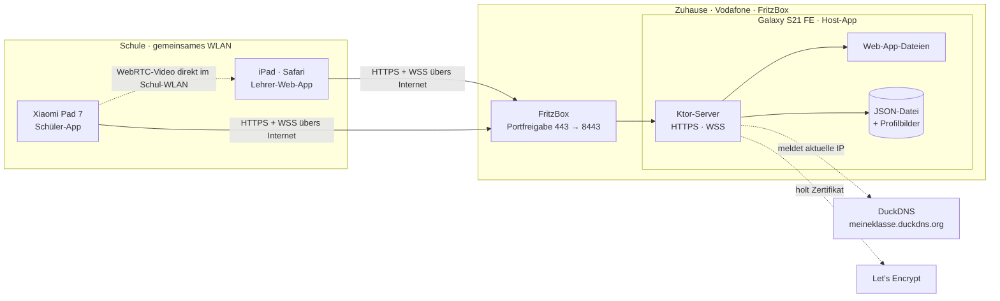
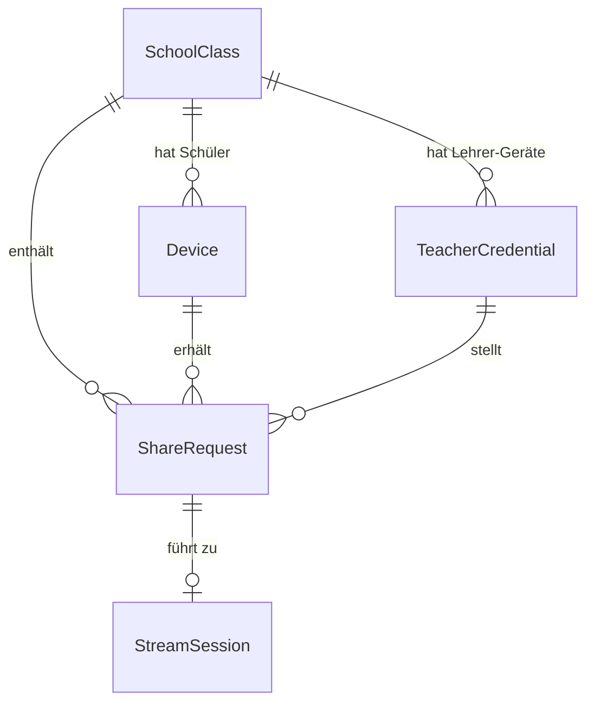
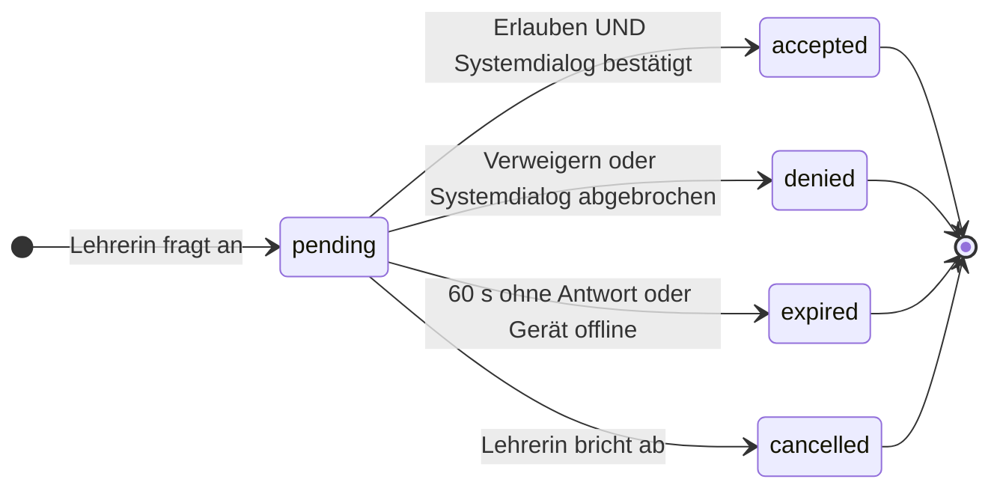
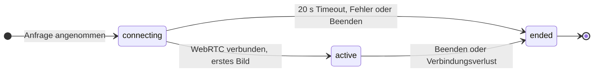
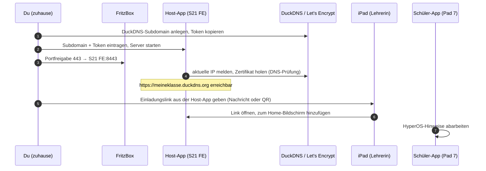
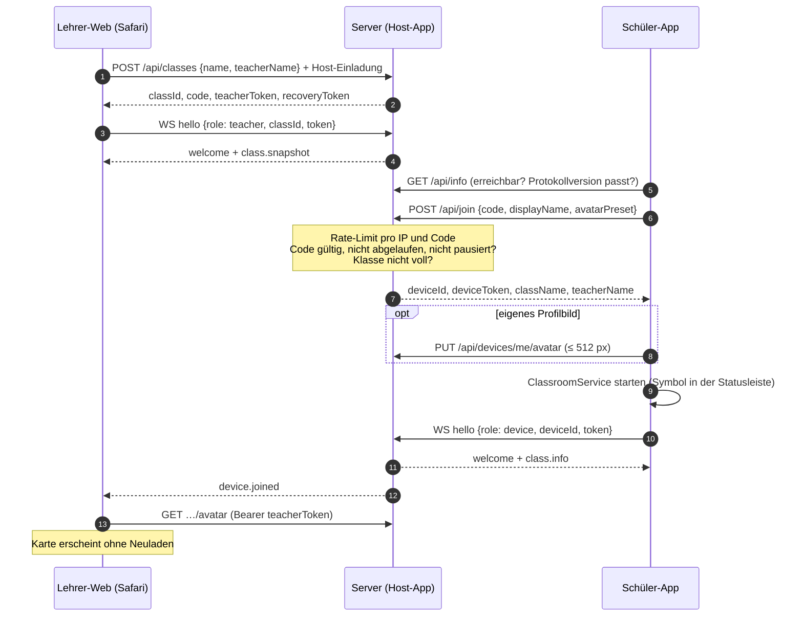
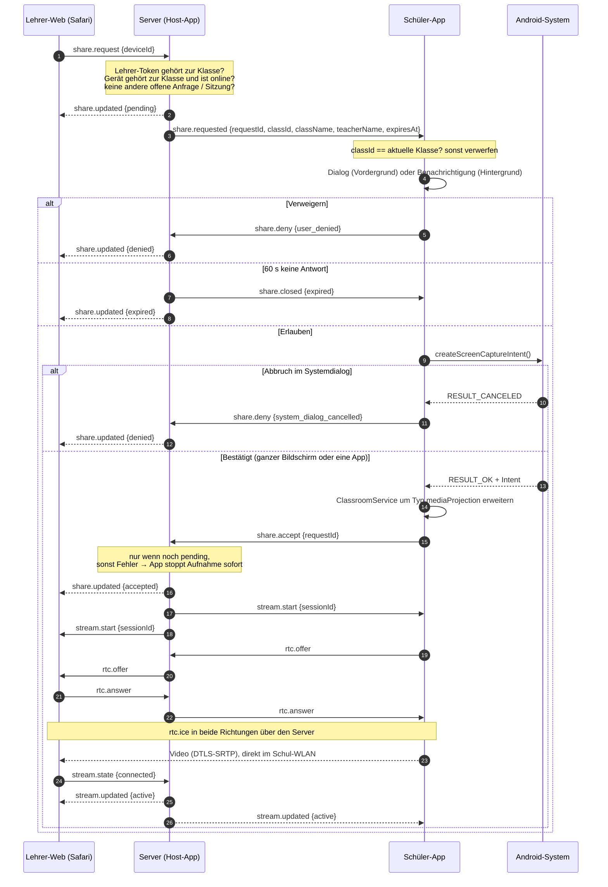
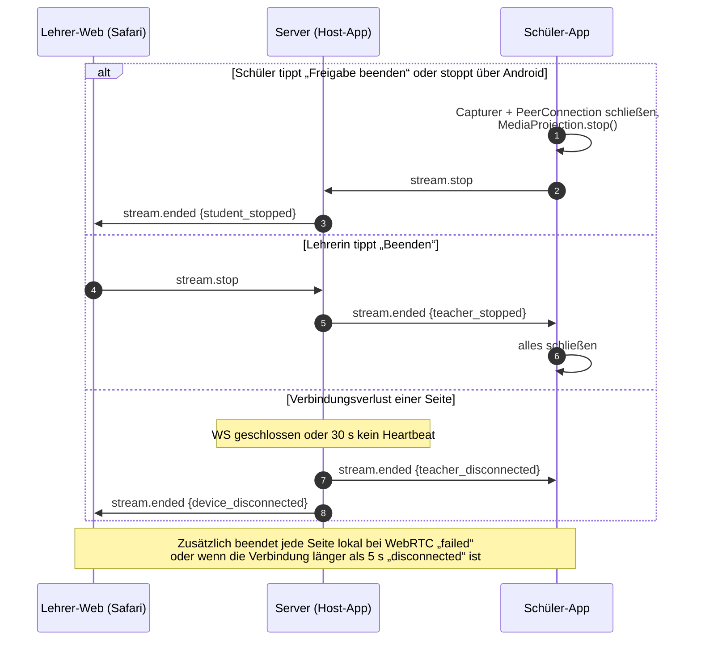

# Architektur

Stand: Phase 1, Revision 3. Dieses Dokument beschreibt *was* gebaut wird und *warum*. Konkrete
Bibliotheksversionen werden erst in der Phase festgelegt, in der sie eingeführt werden, und dann gegen npm
bzw. Maven Central geprüft. Wo ich mir bei einer API oder einem Plattformverhalten nicht sicher bin, steht
das als **Zu prüfen** dabei; alle Prüfpunkte sind in §13 gesammelt.

### Änderungen

| Revision 1 | Revision 2 | **Revision 3 (aktuell)** | Grund |
|---|---|---|---|
| Server auf gemietetem VPS | Host-App auf dem S21 FE, im selben WLAN | **Host-App auf dem S21 FE zuhause**, aus der Schule übers Internet erreichbar | S21 FE bleibt zuhause (≈ 3 km), kein Mietserver, Handy nicht mitnehmen |
| Node.js | Kotlin/Ktor | Kotlin/Ktor | läuft in der Host-App und auf dem PC |
| Let's Encrypt über eigene Domain | eigene lokale CA, Profil aufs iPad | **Let's Encrypt** über kostenlose **DuckDNS**-Adresse | echtes Zertifikat, auf dem iPad der Lehrerin muss nichts installiert werden |
| – | Host-Suche per mDNS | entfällt – feste Adresse `…duckdns.org` | |
| coturn | Mini-STUN als Fallback | Video weiterhin direkt im Schul-WLAN; Fallback in Phase 7 | Geräte sehen sich im Schul-WLAN |
| SQLite | JSON-Datei | JSON-Datei | |
| – | – | **Klassen anlegen nur mit Host-Einladungslink** | der Server ist jetzt öffentlich erreichbar |

---

## 1. Überblick



**Grundprinzipien**

1. **Der Server ist die einzige Autorität** für Klassen, Mitgliedschaften, Anfragen und Sitzungen.
2. **Video fließt nie durch den Server.** Übers Internet zum S21 FE gehen nur Steuerdaten und Profilbilder
   (wenige KB/s). Das Video geht direkt vom Tablet zum iPad im Schul-WLAN, verschlüsselt. Nichts wird
   aufgezeichnet.
3. **Zustimmung ist zweistufig und liegt beim Schülergerät:** App-Dialog *und* Android-Systemdialog.
4. **Jede Phase ist lauffähig.** Der Server läuft ab Phase 3 auch auf dem PC, Phase 3–6 brauchen kein WebRTC.

---

## 2. Technikwahl

| Teil | Wahl | Begründung |
|---|---|---|
| Server | **Kotlin + Ktor** (Server-Framework von JetBrains), reines JVM-Modul | siehe §2.1 |
| HTTP-Engine | Ktor **Netty**-Engine mit TLS | Die CIO-Engine von Ktor kann serverseitig kein TLS. **Zu prüfen in Phase 3** (Spike gleich zu Beginn): Netty mit TLS auf Android. Fallback: CIO auf `127.0.0.1` plus kleiner TLS-Vorschalter mit Androids `SSLServerSocket` in derselben App. |
| WebSocket | Ktor-WebSockets | Browser nutzt die native `WebSocket`-API, Android **OkHttp** |
| Serialisierung | **`kotlinx.serialization`** | gemeinsames Modul `protocol` für Server und Schüler-App → beide Seiten benutzen dieselben Nachrichtenklassen |
| Datenhaltung | Zustand im Speicher, Änderungen sofort als JSON-Datei gespeichert (erst temporäre Datei, dann umbenennen = atomar); Profilbilder als Dateien | Bei ≤ 40 Schülern je Klasse sind das wenige KB. Kein Datenbanktreiber, der sich zwischen Android und PC unterscheidet. Alle Änderungen laufen nacheinander über einen Mutex, damit z. B. „Annehmen“ und „Ablaufen“ nie gleichzeitig passieren. Hinter einer Schnittstelle, später austauschbar gegen SQLite. |
| Zertifikat | **Let's Encrypt** per ACME mit DNS-Prüfung über die DuckDNS-API (TXT-Eintrag) | echtes, überall gültiges Zertifikat; Port 80 muss nicht geöffnet werden. **Zu prüfen in Phase 3:** welcher ACME-Client auf Android läuft (`acme4j` ist der Java-Standard; ob die aktuelle Version auf Android läuft, prüfe ich). Fallback: schlanke eigene ACME-Umsetzung. |
| Bildprüfung | Android `BitmapFactory` (Host) bzw. `javax.imageio` (PC) hinter einer Schnittstelle | dekodieren, Maße prüfen, **neu kodieren** (entfernt EXIF/GPS) |
| Tests Server | JUnit 5 + Ktor `testApplication` | laufen auf dem PC und in CI, ohne Handy |
| Lehrer-Web | React + TypeScript + Vite, eigenes CSS mit CSS-Variablen | Build wird in die Host-APK gepackt |
| Web-Zustand | kleiner eigener Store (`useSyncExternalStore`) | |
| QR-Code | npm-Paket `qrcode` (Web) bzw. ZXing-Core (Host-App) | Host-App zeigt den Einladungslink für die Lehrerin auch als QR |
| Android allgemein | Kotlin, Jetpack Compose, Material 3, eine Activity je App, Navigation Compose | |
| Android-Netzwerk | **OkHttp** (REST + WebSocket) | |
| Feste Adresse | **DuckDNS** (kostenloser DynDNS-Dienst) + Portfreigabe in der FritzBox | Die Host-App meldet DuckDNS selbst ihre aktuelle IP; die Adresse bleibt gleich, auch wenn Vodafone die IP wechselt |
| Android-Speicher | **DataStore** (Preferences) | |
| Bildauswahl | Photo Picker (`ActivityResultContracts.PickVisualMedia`) | keine Speicherberechtigung nötig |
| Android-WebRTC | **`io.getstream:stream-webrtc-android`** | siehe §2.2 |
| APK-Bau | Gradle; zusätzlich **GitHub Actions**, das bei jedem Push beide APKs baut | du kannst die APKs direkt aus GitHub herunterladen und installieren, ohne Android Studio |

### 2.1 Warum der Server jetzt in Kotlin ist

Node.js auf einem nicht gerooteten Handy ginge nur über Termux (keine eigene APK) oder eingebettetes
Node (`nodejs-mobile`), bei dem native Module wie SQLite- oder Bildbibliotheken für Android
nachkompiliert werden müssten. Kotlin/Ktor läuft dagegen normal in einer Android-App.

Weil das Server-Modul **keine Android-Abhängigkeiten** hat, läuft derselbe Code
- in der Host-App auf dem S21 FE,
- auf dem PC (`./gradlew :backend:server:run`) zum Entwickeln, für automatische Tests und in CI,
- später bei Bedarf auch auf einem richtigen Server (dann wieder mit Internetzugang).

### 2.2 WebRTC-Bibliothek für Android

Google veröffentlicht kein gepflegtes offizielles Android-Artefakt mehr (`org.webrtc:google-webrtc` ist
veraltet). Selbst bauen dauert Stunden und braucht viel Platz. Realistische Optionen:

| Option | Bewertung |
|---|---|
| **`io.getstream:stream-webrtc-android`** (GetStream, Apache 2.0, Maven Central) | vorkompiliertes Original-libwebrtc mit der Standard-API `org.webrtc.*` (`PeerConnectionFactory`, `ScreenCapturerAndroid`, Hardware-Encoder …), regelmäßig aktualisiert. Wir nutzen nur das Basis-Artefakt. → **Wahl** |
| `io.github.webrtc-sdk:android` (von LiveKit gepflegt) | gleiche `org.webrtc`-API, gute Alternative |

**Zu prüfen in Phase 7:** aktuelle Version; ob `ScreenCapturerAndroid` bei Größenänderung
`VirtualDisplay.resize()` nutzt oder das Display neu anlegt (ab Android 14 nur einmal pro MediaProjection
erlaubt). Notfalls eigener schlanker Capturer (VirtualDisplay → `SurfaceTextureHelper`).

### 2.3 Videoparameter (Startwerte, in Phase 7 messen)

- Codec **H.264** (Hardware-Encoder im Pad 7, Safari dekodiert hardwarebeschleunigt), Fallback VP8.
- Lange Kante max. **1920 px** (Pad 7: 3200 × 2136), 15–30 fps, `MAINTAIN_RESOLUTION` (lieber weniger
  Bilder pro Sekunde als unlesbarer Text).
- Nur Video, **kein Audio-Track** → `<video muted playsinline>` startet in Safari ohne Autoplay-Sperre.

---

## 3. Repository und Module

```
/                    Gradle-Wurzel für alles in Kotlin
├─ backend/
│  ├─ protocol/      REST-/WebSocket-Nachrichten (kotlinx.serialization), reines Kotlin
│  └─ server/        Ktor-Server, Logik, Rate-Limits, Speicher-Schnittstelle, Tests; PC-Startpunkt
├─ android/
│  ├─ app-student/   Schüler-App (Xiaomi Pad 7)            → APK 1
│  └─ app-host/      Host-App (Galaxy S21 FE), bettet server + Web-App ein → APK 2
├─ web/              Lehrer-Web-App (React + Vite); Build landet in app-host
├─ docs/
└─ .github/workflows Bau beider APKs + Tests
```

---

## 4. Komponenten im Detail

### 4.1 Host-App (Galaxy S21 FE 5G, One UI 8 / Android 16)

Bewusst schlicht – die Klassen werden im iPad verwaltet, nicht hier.

- **Einrichtungsassistent:** DuckDNS-Subdomain und -Token eintragen, Anleitung zur FritzBox-Portfreigabe,
  Akku-Einstellungen.
- **Hauptbildschirm:** Schalter „Server läuft / gestoppt“, Status von DuckDNS (letzte IP-Meldung) und
  Zertifikat (gültig bis …), Anzahl verbundener Geräte, Knopf **„Einladungslink für Lehrkraft“** (Link + QR).
- **`HostService`**: Foreground Service (Typ `specialUse`, für eine nicht über Google Play verteilte App
  unproblematisch) mit Benachrichtigung „Klassenserver läuft“ und „Stoppen“. Er hält
  - den Ktor-Server auf Port **8443** (ohne Root nur Ports über 1024; die FritzBox leitet von außen 443 → 8443),
  - die **DuckDNS-Aktualisierung** (alle 5 min und bei jedem Netzwechsel),
  - den **Zertifikatsabruf und die Erneuerung** (Let's-Encrypt-Zertifikate gelten 90 Tage, Erneuerung nach ~60),
  - einen `PARTIAL_WAKE_LOCK` und einen WLAN-Lock, damit das Handy bei ausgeschaltetem Display erreichbar bleibt.
- **Web-App** wird beim Bauen aus `/web` erzeugt und in die APK gepackt.
- **Daten** (Klassen, Profilbilder, DuckDNS-Token, Zertifikatsschlüssel) im App-eigenen Speicher, Backup
  deaktiviert.

### 4.2 Server (`backend/server`)

- **REST** für Anfrage/Antwort-Fälle, **WebSocket `/ws`** für Live-Ereignisse und Signalisierung.
- Erste WS-Nachricht muss `hello` mit Token sein, sonst wird nach 5 s geschlossen (Tokens nicht in URLs).
- Zustand im Speicher, jede Änderung sofort persistiert (siehe §2).
- **Beim Start** werden offene Anfragen `expired`, offene Sitzungen `ended` (`server_restart`).
- Rate-Limits im Speicher.

### 4.3 Lehrer-Web-App (iPad, Safari)

- Von der Host-App ausgeliefert (gleicher Origin → kein CORS).
- PWA-Manifest + `apple-mobile-web-app-capable` → startet vom Home-Bildschirm ohne Safari-Leisten.
  Home-Bildschirm-App und Safari-Tab haben **getrennten Speicher**.
- Speichert pro Klasse lokal: `classId`, Name, Lehrer-Token, Wiederherstellungslink.
- Profilbilder per `fetch` mit `Authorization`-Header → Blob-URL (keine öffentlichen Bild-URLs).
- Hash-Routen: `#/`, `#/class/:id`, `#/class/:id/student/:deviceId`, `#/recover/<token>`,
  `#/invite/<schlüssel>`.
- **Host-Einladung:** Weil der Server aus dem Internet erreichbar ist, darf nicht jeder Klassen anlegen. Die
  Host-App erzeugt einen Einladungslink `https://…duckdns.org/#/invite/<schlüssel>`; die Web-App merkt sich
  den Schlüssel und schickt ihn beim Anlegen einer Klasse mit. In der Host-App kann der Schlüssel
  jederzeit erneuert werden (bestehende Klassen bleiben).

### 4.4 Schüler-App (Xiaomi Pad 7)

```
MainActivity (Compose, edge-to-edge)
 ├─ Screens: Start · Profil · Beitreten · Beigetreten · Freigabe-Dialog · HyperOS-Hinweis
 ├─ ViewModels (StateFlow)
 ├─ ProfileRepository     – DataStore: Name, Avatar (Preset oder lokale Bilddatei)
 ├─ ClassRepository       – DataStore: Server-Adresse, classId, deviceId, deviceToken
 ├─ ClassConnection       – OkHttp-WebSocket, Heartbeat, Reconnect mit Backoff
 └─ ClassroomService      – EIN Foreground Service für die ganze Klassenzeit:
                             · verbunden: Typ specialUse, Notification „Mit Klasse 7b verbunden“
                             · bei Freigabe: zusätzlich Typ mediaProjection, Notification „Bildschirm
                               wird geteilt“ mit „Beenden“; hält MediaProjection, Capturer, PeerConnection
```

- Ein gemeinsamer Service statt zwei: nur **ein** Symbol in der Statusleiste, das sein Aussehen wechselt.
- Server-Adresse ist in der APK vorbelegt (deine DuckDNS-Adresse) und in den Einstellungen änderbar.
- `minSdk` 29, `targetSdk` 35 (Pad 7: Android 15); Host-App zusätzlich gegen Android 16 getestet. Backups deaktiviert.
- Profilbild wird auf dem Gerät auf max. 512 px verkleinert und als JPEG hochgeladen.
- Keine Kamera- oder Mikrofonberechtigung (QR-Scannen fällt damit weg; Beitritt nur per Code).

---

## 5. Netzwerk: S21 FE zuhause, Geräte in der Schule

### 5.1 Wie die Schule das S21 FE erreicht

Die FritzBox leitet Anfragen auf Port 443 an das S21 FE weiter; DuckDNS sorgt für eine feste Adresse.
Ob das bei deinem Vodafone-Anschluss geht, hängt von der Anschlussart ab:

| Heimanschluss | Weg | Geht? |
|---|---|---|
| **Öffentliche IPv4** („Dual Stack“, bei Vodafone-DSL üblich) | IPv4-Portfreigabe 443 → S21 FE:8443, DuckDNS-A-Eintrag | ja |
| **DS-Lite** (bei Vodafone-Kabel üblich): von außen nur per IPv6 erreichbar | IPv6-Freigabe in der FritzBox für das S21 FE, DuckDNS-AAAA-Eintrag | nur wenn das **Schul-WLAN IPv6** hat |
| DS-Lite **und** Schule ohne IPv6 | nicht direkt erreichbar | siehe §5.5 |

**Selbst prüfen:**
- *FritzBox → Internet → Online-Monitor*: Steht dort „DS-Lite“, ist es DS-Lite. Steht dort eine normale
  IPv4-Adresse ohne DS-Lite, hast du öffentliche IPv4. Faustregel: FritzBox-Modell **6**xxx = Kabel
  (meist DS-Lite), **7**xxx = DSL (meist öffentliche IPv4).
- *In der Schule*: auf dem Pad 7 im Schul-WLAN `test-ipv6.com` öffnen. Zeigt die Seite IPv6 als
  funktionierend an, hat die Schule IPv6.

**FritzBox einrichten** (Details in Phase 3):
*Internet → Freigaben → Portfreigaben → Gerät für Freigaben hinzufügen* → S21 FE wählen →
„Diesem Gerät immer die gleiche IPv4-Adresse zuweisen“ → *Neue Freigabe → Portfreigabe*: TCP, Port am
Gerät 8443, Port extern 443; je nach Anschluss „Freigabe für IPv4“ und/oder „IPv6“ aktivieren.
(Ist in der FritzBox der MyFRITZ!-Fernzugang auf Port 443 aktiv, muss er auf einen anderen Port.)

### 5.2 HTTPS mit echtem Zertifikat

- Du legst bei **DuckDNS** (kostenlos, Anmeldung z. B. mit GitHub- oder Google-Konto) eine Subdomain an,
  z. B. `meineklasse.duckdns.org`, und trägst Subdomain + Token in die Host-App ein.
- Die Host-App holt bei **Let's Encrypt** ein Zertifikat. Den Nachweis, dass ihr die Domain gehört, liefert
  sie über einen TXT-Eintrag bei DuckDNS (DNS-Prüfung) – Port 80 muss dafür nicht offen sein.
- Ergebnis: Safari auf dem iPad und die Schüler-App sehen ein ganz normales, gültiges HTTPS-Zertifikat.
  **Auf dem iPad der Lehrerin muss nichts installiert werden.**
- Der private Schlüssel und das DuckDNS-Token verlassen das S21 FE nie.
- Klartext-HTTP gibt es nur im Debug-Modus auf dem PC zum Entwickeln.

### 5.3 WebRTC: Video bleibt im Schul-WLAN

Signalisierung (SDP, ICE) läuft über den Server zuhause, das Video selbst direkt Tablet → iPad im
Schul-WLAN – du hast bestätigt, dass sich die Geräte dort gegenseitig erreichen. Dein Heimanschluss wird
damit nicht belastet.

**Zu prüfen in Phase 7:** Safari verrät ohne Kamera-/Mikrofonfreigabe seine lokale IP nicht. Für einen
reinen Empfänger sollte die Verbindung trotzdem zustande kommen (Safari prüft die lokalen Adressen des
Tablets, das Tablet lernt Safaris Adresse daraus). Falls nicht, ergänzen wir einen STUN-Server; welcher
(eigener über die FritzBox-Freigabe auf UDP 3478 oder ein öffentlicher), entscheide ich dann anhand von
Messungen.

### 5.4 Was das im Alltag bedeutet

- Das S21 FE muss zuhause **eingeschaltet, im WLAN und am Ladegerät** sein. Fällt es aus, oder fällt das
  Internet zuhause aus, funktioniert ClassroomView in der Schule nicht.
- Das Schul-WLAN muss ausgehendes HTTPS (Port 443) erlauben – das ist praktisch immer so.
- Die Entfernung (3 km) spielt keine Rolle; die Steuerdaten brauchen nur wenige Millisekunden.

### 5.5 Falls der Anschluss von außen nicht erreichbar ist

Nur relevant, wenn DS-Lite **und** die Schule kein IPv6 hat. Optionen, ehrlich bewertet:

| Option | Kosten | Bewertung |
|---|---|---|
| Vodafone nach öffentlicher IPv4 / „Dual Stack“ fragen | je nach Tarif 0 € | bei manchen Tarifen möglich, nicht garantiert |
| Kostenlose Cloud-VM (z. B. Oracle Cloud „Always Free“) mit dem gleichen Server-Code | 0 € | zuverlässig, aber Registrierung verlangt eine Kreditkarte zur Prüfung |
| Tunneldienst (z. B. Cloudflare Tunnel) | 0 € | Anbieter kann Steuerdaten, Namen und Profilbilder mitlesen; auf Android ohne Root nur über Umwege → nicht empfohlen |

---

## 6. Datenmodell



Im Diagramm und im Code heißt `Class` **`SchoolClass`**, weil `class` in Mermaid ein Schlüsselwort ist und
`Class` in Kotlin mit `java.lang.Class` kollidiert. Alle IDs sind zufällige UUIDv4, alle Zeitstempel UTC.
Geheimnisse werden nur als **SHA-256-Hash** gespeichert (256 Bit Zufall, daher kein langsamer
Passwort-Hash nötig).

### `SchoolClass`

| Feld | Typ | Beschreibung |
|---|---|---|
| `id` | UUID | |
| `name` | Text (1–60) | Klassenname |
| `teacherName` | Text (0–60), optional | wird dem Schüler bei Anfragen angezeigt |
| `code` | Text(6), eindeutig, nullable | aktueller Beitrittscode; `null` = kein gültiger Code |
| `codeCreatedAt`, `codeExpiresAt` | Zeitstempel, Ablauf optional | z. B. 1 h / 1 Tag / 7 Tage / nie |
| `joinPaused` | bool | Beitritt vorübergehend gesperrt |
| `maxDevices` | int | Standard 40 |
| `recoveryTokenHash` | Text | |
| `createdAt`, `lastActivityAt` | Zeitstempel | für automatisches Aufräumen |

### `TeacherCredential`

Eine Klasse kann auf mehreren Lehrer-Geräten offen sein; jedes hat ein eigenes Token und kann einzeln
abgemeldet werden.

| Feld | Typ | Beschreibung |
|---|---|---|
| `id`, `classId` | UUID | |
| `tokenHash` | Text, eindeutig | |
| `label` | Text | z. B. „iPad · Safari“ |
| `createdAt`, `lastUsedAt`, `revokedAt` | Zeitstempel | |

### `Device` (Schüler in einer Klasse)

| Feld | Typ | Beschreibung |
|---|---|---|
| `id` | UUID | Zuordnung **nur** hierüber, nie über den Namen |
| `classId` | UUID | genau eine Klasse |
| `tokenHash` | Text, eindeutig | |
| `displayName` | Text (1–40) | |
| `avatarKind` | `preset` \| `image` | |
| `avatarPreset` | Text, nullable | eingebauter Avatar (eigene Grafiken, in Web und App identisch) |
| `avatarFile` | Dateiname, nullable | zufälliger Name, neu kodiertes Bild ≤ 512 × 512 |
| `avatarVersion` | int | wird bei jeder Änderung erhöht |
| `connection` | `online` \| `offline` | |
| `lastSeenAt`, `joinedAt` | Zeitstempel | |
| `removedAt` | Zeitstempel, nullable | entfernt oder ausgetreten → Token ungültig |

### `ShareRequest`

| Feld | Typ | Beschreibung |
|---|---|---|
| `id`, `classId`, `deviceId`, `teacherCredentialId` | UUID | Ziel: genau ein Gerät |
| `status` | `pending` \| `accepted` \| `denied` \| `expired` \| `cancelled` | |
| `reason` | Text, nullable | `user_denied`, `system_dialog_cancelled`, `timeout`, `device_offline`, `teacher_cancelled` |
| `createdAt`, `expiresAt`, `respondedAt` | Zeitstempel | `expiresAt` = `createdAt` + 60 s |

### `StreamSession`

| Feld | Typ | Beschreibung |
|---|---|---|
| `id` | UUID | |
| `shareRequestId` | UUID, eindeutig | |
| `classId`, `deviceId`, `teacherCredentialId` | UUID | |
| `status` | `connecting` \| `active` \| `ended` | |
| `endReason` | Text, nullable | `student_stopped`, `teacher_stopped`, `device_disconnected`, `teacher_disconnected`, `connection_failed`, `projection_stopped`, `connect_timeout`, `device_removed`, `server_restart` |
| `createdAt`, `startedAt`, `endedAt` | Zeitstempel | |

Gespeichert werden **nur Metadaten**, nie Bild- oder Videoinhalte. Abgeschlossene Anfragen und Sitzungen
werden nach 7 Tagen gelöscht.

### Zustandsautomaten



Alle Endzustände sind **endgültig**: Der Server ändert einen Status nur, wenn er noch `pending` ist (unter
dem Mutex geprüft). Ein `share.accept` auf eine abgelehnte oder abgelaufene Anfrage wird immer abgewiesen.



---

## 7. Schnittstellen

### 7.1 REST (`/api`)

| Methode & Pfad | Auth | Zweck |
|---|---|---|
| `GET /api/info` | – | Server-Kennung, Protokollversion (für Host-Suche) |
| `POST /api/classes` | **Host-Einladung** (rate-limitiert) | Klasse anlegen → `classId`, `code`, `teacherToken`, `recoveryToken` |
| `POST /api/classes/recover` | Recovery-Token im Body | neues Lehrer-Token für dieses Gerät |
| `GET /api/classes/:classId` | Lehrer | kompletter Stand |
| `PATCH /api/classes/:classId` | Lehrer | Name, Lehrkraftname, Ablaufzeit, `joinPaused` |
| `POST /api/classes/:classId/code` | Lehrer | Code erneuern (alter sofort ungültig) |
| `POST /api/classes/:classId/recovery` | Lehrer | Wiederherstellungslink erneuern |
| `GET …/teachers` · `DELETE …/teachers/:id` | Lehrer | Lehrer-Geräte anzeigen / abmelden |
| `DELETE /api/classes/:classId/devices/:deviceId` | Lehrer | Schüler entfernen |
| `GET /api/classes/:classId/devices/:deviceId/avatar` | Lehrer | Profilbild |
| `DELETE /api/classes/:classId` | Lehrer | Klasse mit allem löschen |
| `POST /api/join` | – (rate-limitiert) | Code + Name + Avatar-Preset → `deviceId`, `deviceToken`, Klassenname, Lehrkraftname |
| `PATCH /api/devices/me` | Gerät | Name / Avatar-Preset ändern |
| `PUT /api/devices/me/avatar` | Gerät | Profilbild hochladen (max. 1 MB, JPEG/PNG/WebP) |
| `DELETE /api/devices/me` | Gerät | Klasse verlassen |

Auth per `Authorization: Bearer <token>`. Lehrer-Token gehören zu genau einer Klasse, Geräte-Token zu
genau einem `Device`.

### 7.2 WebSocket-Nachrichten (`/ws`)

Umschlag: `{ "type": "...", "id"?: "...", "data": { ... } }`. Ungültiges wird mit `error` beantwortet.

| Richtung | Typ | Bedeutung |
|---|---|---|
| C → S | `hello` | `{ role: "teacher", classId, token }` oder `{ role: "device", deviceId, token }` |
| S → C | `welcome` / `error` | Erfolg bzw. `invalid_token`, `device_removed`, `class_deleted` … |
| C ↔ S | `ping` / `pong` | Heartbeat alle 10 s |
| S → Lehrer | `class.snapshot` | vollständiger Stand nach jedem (Re-)Connect |
| S → Lehrer | `class.updated` | Name, Code, Ablauf, Pause |
| S → Lehrer | `device.joined` · `device.updated` · `device.left` · `device.removed` | Schülerliste live |
| S → Gerät | `class.info` · `removed` | |
| Lehrer → S | `share.request { deviceId }` · `share.cancel { requestId }` | |
| S → Gerät | `share.requested { requestId, classId, className, teacherName, expiresAt }` | |
| S → Gerät | `share.closed { requestId, status }` | abgelaufen / zurückgezogen |
| Gerät → S | `share.deny { requestId, reason }` · `share.accept { requestId }` | `accept` erst **nach** bestätigtem Systemdialog |
| S → Lehrer | `share.updated { requestId, deviceId, status, reason }` | |
| S → beide | `stream.start { sessionId, iceServers }` | `iceServers` leer oder lokaler STUN |
| beide ↔ S | `rtc.offer` · `rtc.answer` · `rtc.ice` | Tablet ist Offerer, Safari antwortet `recvonly` |
| beide → S | `stream.state` · `stream.stop` | |
| S → beide | `stream.updated` · `stream.ended { reason }` | |
| S → Lehrer | `stream.content { visible }` | geteilte App gerade (nicht) sichtbar |

`rtc.*` wird nur zwischen den zwei Teilnehmern einer offenen Sitzung weitergeleitet.

---

## 8. Abläufe

### 8.1 Einmalige Einrichtung



### 8.2 Klasse erstellen und beitreten



Danach verbindet sich die App immer mit `deviceId` + `deviceToken`, **ohne Code**. „Code erneuern“
betrifft beigetretene Schüler deshalb nicht.

### 8.3 Freigabe anfragen



Die 60-s-Frist läuft auch während des Systemdialogs weiter.

### 8.4 Stream beenden



Wird die **Host-App** beendet, verliert das S21 FE das WLAN oder fällt das Internet zuhause aus, enden alle
Streams auf beiden Seiten (beide verlieren den WebSocket).

---

## 9. Schüler-App: Android-Besonderheiten

### 9.1 Bildschirmaufnahme

1. `MediaProjectionManager.createScreenCaptureIntent()` aus der Activity, **ohne** vorgegebene Konfiguration
   → Nutzer wählt **ganzen Bildschirm oder eine einzelne App**.
2. Bei `RESULT_OK`: `ClassroomService.startForeground(…, SPECIAL_USE | MEDIA_PROJECTION)`.
3. Erst danach `getMediaProjection()`, Callback registrieren, genau einmal `createVirtualDisplay`.

- **Einwilligung pro Sitzung:** Der Ergebnis-Intent wird nie gespeichert oder wiederverwendet.
- **Einzelne App:** `onCapturedContentResize(w, h)` passt die Größe an,
  `onCapturedContentVisibilityChanged(visible)` meldet der Lehrerin „geteilte App gerade nicht sichtbar“.
- **`onStop()`** (Stopp über System, Sperren …) → Sitzung `ended` (`projection_stopped`).
- **Drehung:** `VirtualDisplay.resize()` bei Konfigurationsänderung.
- **Manifest:** `FOREGROUND_SERVICE`, `FOREGROUND_SERVICE_MEDIA_PROJECTION`,
  `FOREGROUND_SERVICE_SPECIAL_USE`, `POST_NOTIFICATIONS`, `INTERNET`, `ACCESS_NETWORK_STATE`.
  **Keine** Kamera, **kein** Mikrofon.

### 9.2 Anfragen im Hintergrund

- Durch den `ClassroomService` bleibt die Verbindung auch im Hintergrund bestehen.
- Kanal „Freigabe-Anfragen“ mit `IMPORTANCE_HIGH` (Heads-up).
- **„Verweigern“** direkt in der Benachrichtigung. **„Erlauben“** öffnet die App, die sofort den
  Systemdialog zeigt – der muss aus einer sichtbaren Activity kommen.
- Kein Full-Screen-Intent (ab Android 14 Wecker- und Telefonie-Apps vorbehalten).

### 9.3 HyperOS

HyperOS beendet Hintergrund-Apps aggressiv und unterdrückt oft Heads-up-Benachrichtigungen.
Einstellungen (Menünamen variieren je HyperOS-Version, ich prüfe sie in Phase 4):

1. **Autostart** erlauben (Einstellungen → Apps → App verwalten → ClassroomView).
2. **Akku-Sparmodus** der App: **„Keine Einschränkungen“**.
3. Benachrichtigungen: „Schwebende Benachrichtigungen“ und Sperrbildschirm für „Freigabe-Anfragen“ erlauben.
4. App in der Übersicht der letzten Apps **sperren** (Karte gedrückt halten → Schloss).
5. Damit das Statusleisten-Symbol sichtbar ist: *Einstellungen → Benachrichtigungen & Kontrollzentrum →
   Statusleiste → Benachrichtigungssymbole anzeigen* (HyperOS blendet sie teils standardmäßig aus).

Die App zeigt einen Hinweis-Screen mit diesen Schritten und springt, wo öffentlich möglich, direkt in die
Einstellungen.

### 9.4 Das Symbol in der Statusleiste („blau wie bei Apple“)

Ehrliche Einordnung:

- Der **rechte** Bereich der Statusleiste (Bluetooth, WLAN, Akku) ist dem System vorbehalten. Apps können
  dort unter Android **kein** eigenes Symbol ablegen – ohne Root geht das nicht.
- Apps erscheinen **links** in der Statusleiste mit dem kleinen Symbol ihrer laufenden Benachrichtigung.
  Diese Symbole färbt Android/HyperOS **einheitlich** (weiß bzw. dunkel). Eine eigene Farbe wie Blau
  übernimmt die Statusleiste nicht.

Was ich daher umsetze:

| Wo | Was |
|---|---|
| Statusleiste (links) | eigenes, gut erkennbares Klassen-Symbol, solange du verbunden bist; während der Freigabe wechselt es auf ein Bildschirm-Symbol |
| Benachrichtigungsleiste | dauerhafte Benachrichtigung „Mit Klasse 7b verbunden“, **blau eingefärbt** (`setColorized`, bei Foreground Services erlaubt; ob HyperOS die Einfärbung anzeigt, **prüfe ich am Gerät**) |
| In der App | blaue „Verbunden“-Kapsel oben, während der Freigabe deutlich als „Bildschirm wird geteilt“ |
| System | Android zeigt während der Aufnahme zusätzlich seinen eigenen Hinweis, den wir nicht beeinflussen |

### 9.5 Layout

Window-Size-Classes, Hoch- und Querformat, Zustand in ViewModels. Edge-to-Edge (Pflicht bei
`targetSdk 35`).

---

## 10. Host-App: Samsung-Besonderheiten (S21 FE, One UI 8)

Samsungs One UI beendet Hintergrund-Apps gern. Die Host-App läuft als Foreground Service mit Wake- und
WLAN-Lock. Zusätzlich (Menünamen prüfe ich in Phase 3 unter One UI 8):

1. *Einstellungen → Apps → ClassroomView Host → Akku* → **„Nicht eingeschränkt“**.
2. *Akku → Hintergrundnutzungslimits* → Host-App zu **„Nie schlafende Apps“**;
   „Nicht verwendete Apps in Standby versetzen“ ggf. ausschalten.
3. Dauerhaft **am Ladegerät** – dann greift der Android-Tiefschlaf (Doze) nicht. Optional in den
   Akku-Einstellungen „Akku schützen“ (Laden bis 80 %) einschalten, das schont den Akku im Dauerbetrieb.
4. In der FritzBox dem S21 FE eine feste IP geben (siehe §5.1).

Die Host-App zeigt diese Hinweise und fragt die Ausnahme von der Akku-Optimierung an
(`ACTION_REQUEST_IGNORE_BATTERY_OPTIMIZATIONS`). Empfehlung: Auf dem S21 FE möglichst keine sensiblen
privaten Daten, weil der Server aus dem Internet erreichbar ist (siehe `security.md` §4.9).

---

## 11. Echtzeit und Zuverlässigkeit

| Thema | Umsetzung |
|---|---|
| Heartbeat | Client sendet alle 10 s `ping`. Server: 30 s ohne Nachricht → `offline`, Verbindung zu. Client: 25 s ohne `pong` → neu verbinden. |
| Reconnect | Backoff mit Zufallsanteil 1 s, 2 s, 4 s … max. 30 s; sofort bei Netzwechsel (Android) bzw. `online`/`visibilitychange` (Web). |
| Vollständiger Abgleich | nach jedem Lehrer-Reconnect `class.snapshot`; die Web-App ersetzt ihren Zustand komplett |
| Keine Doppelkarten | Karten nach `deviceId`; pro Gerät gilt nur die neueste Verbindung |
| Keine hängenden Anfragen | Timer 60 s; Gerät offline → `expired`; Lehrerverbindung weg → `cancelled` |
| Keine verwaisten Streams | Ende bei `stream.stop`, Verbindungsverlust einer Seite, WebRTC `failed`, 20 s in `connecting`, MediaProjection-Stopp, Entfernen des Schülers, Server-Neustart. Max. **eine** Sitzung je Klasse bis Phase 9. |
| „Sofort“ | sauberes Beenden < 1 s; harter Netzverlust über WebRTC in wenigen Sekunden bzw. Heartbeat max. 30 s |

---

## 12. Design-Leitlinien (Details in Phase 2)

- Ruhig, viel Weißraum, Systemschrift (`-apple-system, system-ui` im Web).
- Abgerundete Karten (≈ 16 px), runde Avatare, dezente Schatten, kleine Statuspunkte (online grün,
  offline grau, Freigabe aktiv = Akzentblau mit Bildschirm-Symbol).
- Eine gedeckte **blaue** Akzentfarbe in allen drei Oberflächen; keine Verläufe, keine Neonfarben;
  Hell- und Dunkelmodus.
- Touch-Ziele ≥ 44 pt (iPad) bzw. 48 dp (Android).
- Code groß in Monospace, gruppiert `K7P·4XM`; Eingabe mit oder ohne Trennzeichen.
- Eigene, einfache Avatar-Grafiken aus einer gemeinsamen SVG-Quelle.

---

## 13. Risiken und Prüfpunkte

| Phase | Prüfpunkt | Plan B |
|---|---|---|
| vor 3 | Heimanschluss von außen erreichbar (IPv4 bzw. IPv6 + Schul-IPv6) | §5.5 |
| 3 (zu Beginn) | Ktor-Netty mit TLS läuft auf Android | CIO lokal + eigener TLS-Vorschalter mit `SSLServerSocket` |
| 3 | ACME-Client (Let's Encrypt) läuft auf Android | schlanke eigene ACME-Umsetzung |
| 3 | IPv6-Weg: FritzBox-Freigabe bleibt gültig, obwohl Android seine IPv6-Adressen wechseln kann | Freigabe neu anlegen lassen / IPv4 bevorzugen |
| 3 | Hintergrundverhalten unter One UI 8 (Android 16) | Hinweise anpassen |
| 4 | HyperOS-Menünamen, Benachrichtigungssymbole, `setColorized` | Hinweise anpassen |
| 7 | Safari empfängt WebRTC ohne STUN | STUN ergänzen |
| 7 | `ScreenCapturerAndroid` und Größenänderung ab Android 14 | eigener Capturer |
| 7 | Verhalten von HyperOS beim Sperren des Tablets während der Freigabe | Stream sauber beenden und anzeigen |

---

## 14. Offene Fragen

1. Was steht in der **FritzBox unter *Internet → Online-Monitor*** – „DS-Lite“ oder eine normale IPv4-Adresse?
   Und welches FritzBox-Modell ist es (Nummer auf der Unterseite)?
2. Nur falls DS-Lite: Zeigt **`test-ipv6.com`** auf dem Pad 7 **im Schul-WLAN** IPv6 als funktionierend an?
3. Ist es für dich in Ordnung, bei **DuckDNS** eine kostenlose Adresse anzulegen (Anmeldung mit GitHub- oder
   Google-Konto)?

**Annahmen**, falls nichts anderes gesagt wird: Oberflächen auf Deutsch; max. 40 Schüler pro Klasse; ein
Stream gleichzeitig bis Phase 9.
