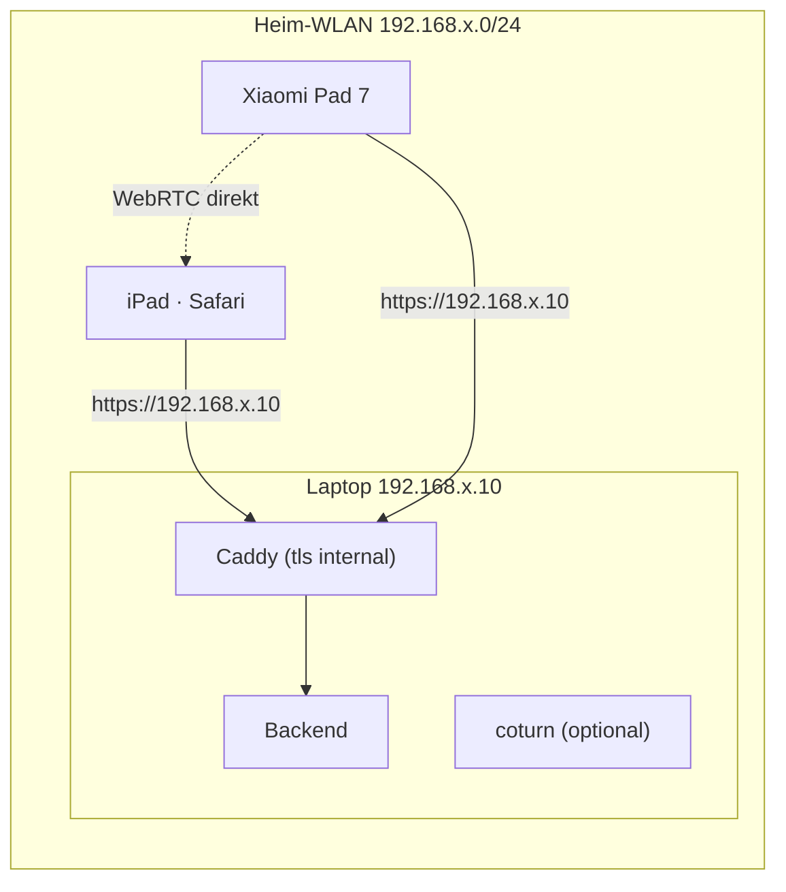

# Hosting, Kosten und lokaler Testbetrieb

Stand: Phase 1. Die konkreten Konfigurationsdateien (Docker Compose, Caddyfile, `turnserver.conf`) folgen
in Phase 3 (Backend + Caddy) und Phase 7 (coturn).

---

## 1. Was selbst gehostet werden muss

| Baustein | Wozu | Anforderungen |
|---|---|---|
| **Server** (VPS oder eigener Rechner) | Backend, Web-App, coturn | 1–2 vCPU, 1–2 GB RAM reichen; öffentliche **IPv4** (iPads/Schulnetze sind nicht überall IPv6-fähig) |
| **Domain** | HTTPS-Zertifikat, feste Adresse für App und Safari | z. B. `classroom.example.de` und optional `turn.example.de` |
| **TLS-Zertifikat** | HTTPS/WSS (Safari und Android verlangen es, WebRTC in Safari ohnehin nur in sicherem Kontext sinnvoll) | Let's Encrypt, von Caddy automatisch geholt und erneuert – kostenlos |
| **Reverse Proxy** (Caddy) | TLS, statische Web-App, Weiterleitung `/api` und `/ws` ans Backend | Ports 80 + 443 TCP |
| **Backend** | REST, WebSocket, SQLite | intern, nur über Caddy erreichbar |
| **coturn** | STUN (eigene öffentliche Adresse ermitteln) und TURN (Relay, wenn keine Direktverbindung möglich) | 3478 UDP/TCP, 5349 TCP (TLS), Relay-Portbereich z. B. 49160–49200 UDP |

### Wann wird TURN gebraucht?

Wenn iPad und Tablet im **selben** WLAN sind und sich gegenseitig erreichen, läuft das Video direkt.
TURN wird gebraucht, wenn

- die Geräte in verschiedenen Netzen sind (z. B. Schüler im Mobilfunknetz),
- das WLAN **Client-Isolation** hat (in Schul- und Gäste-WLANs häufig – Geräte sehen sich dann nicht),
- UDP gesperrt ist.

Sind in der Schule nur Port 443/TCP offen, hilft nur **TURN über TLS auf Port 443**. Da Caddy 443 schon
belegt, braucht coturn dafür eine **zweite IPv4-Adresse** (bei vielen Anbietern ca. 1 €/Monat extra) oder
einen eigenen kleinen Server. Das richten wir nur ein, wenn es nötig ist (siehe Offene Fragen in
`architecture.md`).

---

## 2. Laufende Kosten (Richtwerte, ohne Gewähr)

Preise ändern sich; bitte beim Anbieter aktuell nachsehen.

| Posten | ca. Kosten |
|---|---|
| Kleiner VPS in der EU (2 vCPU, 2–4 GB RAM, ≥ 20 TB Traffic inkl., z. B. bei Hetzner, netcup o. ä.) | **ca. 4–8 € / Monat** |
| Domain (`.de`) | **ca. 5–15 € / Jahr** |
| TLS-Zertifikat (Let's Encrypt) | **0 €** |
| Optional zweite IPv4 für TURN auf 443 | ca. 1 € / Monat |
| **Summe** | **ca. 5–10 € / Monat** |

**Traffic-Abschätzung:** Ein Bildschirmstream braucht etwa 1–3 Mbit/s. Bei 2 Mbit/s sind das ≈ 0,9 GB
pro Stunde. Läuft er über TURN, geht er durch den Server hinein *und* hinaus ≈ **1,8 GB/Stunde**. Selbst bei
täglich mehreren Stunden mit 4 parallelen Streams bleibt man weit unter typischen Inklusiv-Volumen.
CPU-Last ist vernachlässigbar, weil der Server nichts kodiert.

**Alternative: Server zu Hause** (Raspberry Pi, NAS, alter PC) mit DynDNS: keine Serverkosten, aber
- es braucht eine echte öffentliche IPv4 (bei vielen Kabel-/Glasfaseranschlüssen gibt es nur DS-Lite/CGNAT
  → TURN von außen nicht erreichbar),
- Portfreigaben für 80/443 und die TURN-Ports im Router,
- Upload-Bandbreite des Anschlusses begrenzt die Relay-Streams.

---

## 3. Lokales Testen im WLAN (ohne öffentlichen Server)

Ein Laptop im selben WLAN wie iPad und Xiaomi Pad betreibt alles per Docker Compose.

### Variante A – schnell (für Phase 3–6)

- Backend läuft per HTTP auf `http://192.168.x.10:8080`.
- Android-**Debug**-Build erlaubt Klartext nur für diese lokale Adresse (Network Security Config im
  Debug-Source-Set); Server-URL in der Entwickleroption eintragen.
- Safari öffnet `http://192.168.x.10:8080`. Einschränkungen ohne HTTPS: Zwischenablage-API
  („Kopieren“) und manche Web-APIs sind nur im sicheren Kontext verfügbar → die Web-App bekommt dafür
  Fallbacks (Text markieren statt Kopieren).

### Variante B – realistisch (ab Phase 7, für WebRTC empfohlen)

- Caddy mit `tls internal` stellt ein Zertifikat für die IP-Adresse des Laptops aus (eigene lokale CA).
- **iPad:** Caddy-Root-Zertifikat (`root.crt`) per AirDrop/Mail aufs iPad, als Profil installieren, dann
  unter *Einstellungen → Allgemein → Info → Zertifikatsvertrauenseinstellungen* volles Vertrauen aktivieren.
- **Android:** Root-Zertifikat als Nutzerzertifikat installieren; der **Debug**-Build vertraut
  Nutzerzertifikaten (Network Security Config `<debug-overrides>`), der Release-Build nicht.
- Alternativ `mkcert` statt `tls internal` – gleiches Prinzip.

**Zu prüfen in Phase 7:** Safari gibt ohne Kamera-/Mikrofonfreigabe keine lokalen Host-IP-Kandidaten
preis. Für einen reinen Empfänger sollte die Verbindung trotzdem zustande kommen (das Android-Gerät liefert
seine Host-Kandidaten, Safari antwortet, der Weg wird als „peer-reflexive“ erkannt). Falls nicht, starten wir
coturn lokal mit und geben ihn als STUN/TURN an. Lokales coturn darf dann **keine** Sperre privater
IP-Bereiche (`denied-peer-ip`) haben, sonst kann es im Heimnetz nicht weiterleiten – im öffentlichen Betrieb
ist diese Sperre dagegen Pflicht.

### Typische Stolpersteine im WLAN

- **Client-Isolation / Gast-WLAN:** Geräte erreichen sich nicht → Heim-WLAN nutzen oder lokales coturn.
- **Laptop-Firewall** blockiert eingehende Verbindungen auf 443/8080/3478.
- **IP-Adresse des Laptops ändert sich** → im Router fest zuweisen.
- `.local`-Namen funktionieren auf dem iPad, auf Android nicht zuverlässig → IP-Adresse verwenden.

---

## 4. Betrieb (Kurzfassung, Details in Phase 10)

- Docker Compose mit drei Diensten: `caddy`, `backend`, `coturn` (coturn mit `network_mode: host`, da es
  viele UDP-Ports braucht).
- Firewall (z. B. `ufw`): 22, 80, 443/TCP, 3478/UDP+TCP, 5349/TCP, Relay-Portbereich/UDP.
- Unbeaufsichtigte Sicherheitsupdates, regelmäßiges Backup der SQLite-Datei (verschlüsselt, da sie Namen
  und Profilbilder enthält).
- Geheimnisse (`TURN_SECRET` usw.) nur in `.env`, nie im Repository; `.env.example` wird mitgeliefert.
